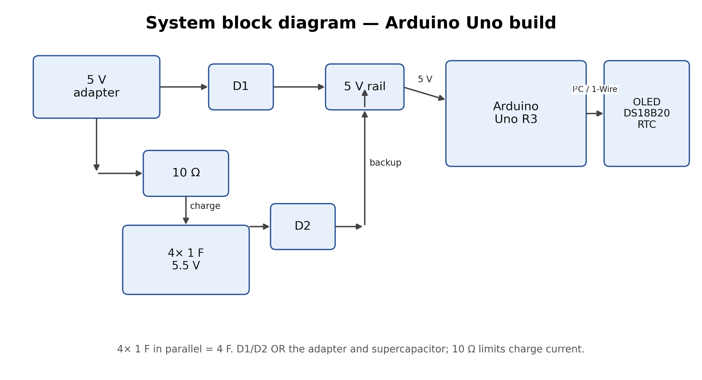

# Power-Fail-Safe Sensor Logger — Arduino Uno Build Report

**Student:** Dandu Surath Preetham  
**Roll number:** BL.SC.U4CSE24212  
**Project:** Power-Fail-Safe Sensor Logger with Supercapacitor Hold-Up  
**Board:** Arduino Uno R3  
**Date:** 10 November 2026

---

## 1. Project overview

This project is a sensor logger that survives a short power failure. It detects when the 5 V adapter is unplugged, uses a supercapacitor bank to hold up the Arduino for a few seconds, saves the last temperature reading and timestamp to EEPROM with a CRC, displays the status on an OLED, and restores the record when power returns.

The demonstration is:

```text
Power on → OLED shows POWER OK
Unplug adapter → POWER LOST → SAVING → SAVED
Plug adapter back in → RECOVERED with the last reading and timestamp
```

The Arduino Uno R3 is used instead of the ESP32. It is a 5 V board with a 10-bit ADC, 1 KB EEPROM, and 2 KB SRAM. The circuit and firmware are adapted to those limits.

---

## 2. System block diagram



*Figure 1: System block diagram. D1/D2 provide adapter OR-ing; the 10 Ω resistor limits the supercapacitor charge current; the 4×1 F bank provides the hold-up energy.*

---

## 3. Components and their purpose

| Component | Qty | Purpose in this project | Why this part/value |
|---|---:|---|---|
| **Arduino Uno R3** | 1 | Main controller: reads the voltage dividers and DS18B20, drives the OLED, LED, buzzer, and button, stores the record in EEPROM | 5 V logic, 10-bit ADC, 1 KB EEPROM, 2 KB SRAM; already owned |
| **1 F, 5.5 V supercapacitor** | 4 | Energy storage for the hold-up | 4 in parallel = 4 F at 5.5 V; 5.5 V rating is safe for a 5 V rail |
| **1N5819 Schottky diode** | 2 | D1: connects the adapter to the 5 V rail and blocks backfeed. D2: connects the supercapacitor to the 5 V rail when the adapter is removed | Low forward drop (~0.3 V at 0.1–0.5 A), 1 A rating; a 1N4007/RL207 drops too much |
| **10 Ω, 5 W resistor** | 1 | Limits the initial supercapacitor charge current | 5 V / 10 Ω = 0.5 A initial; 2.5 W peak; 5 W rating gives margin |
| **10 kΩ resistor** | 4 | Two 10k/10k voltage dividers: adapter voltage → A0, supercapacitor voltage → A1 | Scales 5 V to 2.5 V, safe for the 5 V ADC |
| **4.7 kΩ resistor** | 1 | Pull-up for the DS18B20 1-Wire data line | Keeps the data line high when idle |
| **220 Ω resistor** | 2 | LED current limiting | ~14 mA at 5 V; protects the LED and the GPIO |
| **0.96" SSD1306 OLED** | 1 | Shows `POWER OK`, `POWER LOST`, `SAVING`, `SAVED`, `RECOVERED`, temperature, time, SC voltage, PF count | 128×64 I²C display; only 4 pins |
| **DS18B20 temperature sensor** | 1 | Measures the logged temperature | Digital 1-Wire sensor; ±0.5 °C; waterproof probe is easy to mount |
| **DS3231 RTC module** | 1 | Provides the timestamp that survives power loss | I²C RTC with coin-cell backup; accurate |
| **CR2032 / LIR2032 coin cell** | 1 | Keeps the RTC running when the main power is off | Check whether the module charges; use LIR2032 if it does |
| **LED, 5 mm** | 1 | Visual trigger/status indicator | Cheap; visible during the demo |
| **Active buzzer** | 1 | Audible confirmation on `SAVED`/`RECOVERED` | Cheap; the demo can be heard |
| **Push button** | 1 | Manual log / test trigger | Optional but useful; internal pull-up |
| **Half-size breadboard** | 1 | Prototyping the logic, sensors, and dividers | 400 tie points; keep the supercapacitor off it |
| **2-pin terminal block** | 1 | Secure connection for the supercapacitor and adapter leads | The 1 F leads and adapter wires are too thick for a breadboard |
| **Small perfboard, 5×7 cm** | 1 | Mounts the four 1 F capacitors and their common +/− buses | Optional if using 4-pin terminal blocks or Wago nuts |
| **Solder wire + heat-shrink** | 1 | Joins and insulates the capacitor buses | Not needed if using terminal blocks/Wago |
| **5-way Wago lever nuts** — no-solder option | 2 | Join all four + leads and all four − leads without soldering | One for SC+, one for SC−; add a red/black wire to the terminal block |
| **4-pin terminal block** — no-solder option | 2 | Alternative to Wago: one capacitor lead per screw, bridge the terminals | One block for SC+, one for SC− |
| **Jumper wires** | 1 set | Connections between the Uno, OLED, RTC, DS18B20, dividers, LED, buzzer, button | M–M and M–F |
| **5 V, 2 A adapter** | 1 | Primary 5 V supply; the thing that is unplugged | 2 A gives margin for the 0.5 A charge current |
| **Micro-USB breakout** | 1 | Gives 5 V/GND screw/pin access from the adapter | Avoids cutting the adapter cable |
| **USB-A to USB-B cable** | 1 | Programming the Uno | Only for programming; unplug during the demo |
| **Digital multimeter** | 1 | Measures the 5 V rail, dividers, supercapacitor voltage, and hold-up | Essential for setup and results |
| **100 nF ceramic capacitor** | 2 | Optional ADC noise filter across A0–GND and A1–GND | Not required for the basic demo |
| **MT3608 5 V boost** | 1 | Optional: extends the hold-up if the measured time is under ~3 s | Not used in the basic build |

**Important:** D1 and D2 in this report are the two **1N5819 diodes**. The push button uses **Arduino digital pin 2** — a different thing.

---

## 4. Arduino Uno pin map

| Function | Arduino Uno pin | Notes |
|---|---|---|
| OLED SDA | **A4** | I²C data |
| OLED SCL | **A5** | I²C clock |
| DS3231 SDA | **A4** | Shared I²C bus |
| DS3231 SCL | **A5** | Shared I²C bus |
| DS18B20 data | **D4** | 4.7 kΩ pull-up to 5 V |
| Adapter-sense divider | **A0** | 10k/10k; divider before D1 |
| Supercapacitor-sense divider | **A1** | 10k/10k; from SC+ |
| LED | **D8** | 220 Ω → LED → GND |
| Buzzer | **D9** | Active buzzer → GND |
| Button | **D2** | Button → GND; `INPUT_PULLUP` |
| Power input | **5V pin** | **Not VIN**; from the 5 V rail |
| Ground | **GND** | Common ground |

**I²C addresses:** OLED `0x3C` (fallback `0x3D`); DS3231 `0x68`.

---

## 5. Step-by-step connections

> **Before you start:** unplug the 5 V adapter and the Uno USB cable. Check the polarity of every supercapacitor. Work on a non-metal surface. Keep the 10 Ω resistor away from plastic.

### Step 1 — Prepare the supercapacitor bank

You need **4× 1 F, 5.5 V** capacitors. If you have 5, use 5 for more margin. Do not use fewer than 3.

1. Identify the **negative** lead of each capacitor: the side with the stripe is negative.
2. Choose one assembly method:

**A. Solder + perfboard (if you have a soldering iron):**

- Solder all four **+** leads to a common copper wire/perfboard pad.
- Solder all four **−** leads to a second common wire/pad.
- Solder a red wire to the + bus and a black wire to the − bus.
- Heat-shrink the joints.

**B. No-solder Wago lever nuts (recommended if you do not have a soldering iron):**

- Use two **5-way Wago 221 lever nuts** (or two 4-way lever nuts).
- Lift the lever on the first Wago. Insert all four capacitor **+** leads plus a short **red wire** into the ports. Close the lever. Tug each lead gently to confirm it is clamped.
- Repeat with the second Wago for all four **−** leads plus a short **black wire**.
- The red/black wires become the SC+/SC− connection to the terminal block.

**C. No-solder terminal blocks:**

- Use two **4-pin screw terminal blocks** (one for +, one for −).
- Put one capacitor lead under each screw and tighten.
- Bridge all four screw terminals with short jumper wires to make a common bus.
- Connect a red wire from the + bus and a black wire from the − bus to the 2-pin terminal block.

**D. Using the two 2-pin terminal blocks you already have:**

- Try putting **two + tabs under each screw** of one 2-pin block; do the same with two − tabs under each screw of the other block.
- Bridge the two screws of each block with a short jumper wire so all four tabs are common.
- If the tabs do **not** fit two per screw, do not force them. Use the 4-pin blocks/Wago method, or ask a local shop to solder the four capacitors in parallel.
- The 2-pin block method works only if the screw clamp closes firmly on both tabs; check by gently pulling each tab.

3. Connect the common **+** to one terminal of the **2-pin terminal block**; label it **SC+**.
4. Connect the common **−** to the other terminal; label it **SC−/GND**.
5. Measure from SC+ to SC− with the multimeter on resistance/continuity: it should not be a short. A capacitor will show a changing resistance as it charges.
6. Do not connect the bank to power yet.

**Purpose:** the four 1 F capacitors in parallel give **4 F at 5.5 V**. The terminal block takes the mechanical strain off the breadboard. The Wago/terminal-block method avoids soldering and keeps the four leads securely joined.

### Step 2 — Build the power path

Use the micro-USB breakout for the adapter. If you have a DC jack or bench supply, the 5 V/GND nodes are the same.

| Connection | From | To | Purpose |
|---|---|---|---|
| 1 | 5 V adapter → micro-USB breakout | Breakout 5 V output | Primary 5 V source |
| 2 | Breakout 5 V | **D1 anode** (the non-stripe end) | Adapter current enters D1 |
| 3 | **D1 cathode** (stripe end) | **5 V rail** | Adapter powers the rail; D1 blocks backfeed |
| 4 | Breakout 5 V | **10 Ω, 5 W resistor** left end | Charge path |
| 5 | 10 Ω resistor right end | **SC+** | Limited current charges the supercapacitor bank |
| 6 | **SC+** | **D2 anode** (non-stripe end) | Supercapacitor current enters D2 |
| 7 | **D2 cathode** (stripe end) | **5 V rail** | Supercapacitor powers the rail when the adapter is removed |
| 8 | Breakout GND | **GND rail** | Common ground |
| 9 | SC− | **GND rail** | Supercapacitor negative |

**Diode orientation:** the **stripe is the cathode**. For D1, the stripe points toward the 5 V rail. For D2, the stripe also points toward the 5 V rail. If either diode is reversed, the board will not power correctly.

**Purpose:** D1 and D2 form a diode-OR. D1 lets the adapter power the rail and prevents the supercapacitor from feeding back into the adapter. D2 lets the supercapacitor power the rail when the adapter is removed. The 10 Ω resistor is only in the charge path; it is not in the backup discharge path.

### Step 3 — Adapter-sense divider (A0)

This divider must be on the **adapter side of D1**, not after D1.

| Connection | From | To | Purpose |
|---|---|---|---|
| 1 | Breakout 5 V (before D1) | **10 kΩ** resistor #1 left end | Top of divider |
| 2 | 10 kΩ #1 right end | **A0** | Scaled adapter voltage |
| 3 | A0 | **10 kΩ** resistor #2 left end | Bottom of divider |
| 4 | 10 kΩ #2 right end | **GND** | Divider ground |

At 5 V, A0 should read about **2.5 V**. When the adapter is unplugged, A0 should fall to **0 V**. If A0 stays at 2.5 V after unplugging, the divider is after D1 — move it before D1.

**Purpose:** the Uno ADC accepts 0–5 V. The divider halves the adapter voltage so the firmware can detect loss safely. It must see the adapter directly; after D1, the supercapacitor would hold it high and the power failure would be missed.

### Step 4 — Supercapacitor-sense divider (A1)

| Connection | From | To | Purpose |
|---|---|---|---|
| 1 | **SC+** | **10 kΩ** resistor #3 left end | Top of divider |
| 2 | 10 kΩ #3 right end | **A1** | Scaled supercapacitor voltage |
| 3 | A1 | **10 kΩ** resistor #4 left end | Bottom of divider |
| 4 | 10 kΩ #4 right end | **GND** | Divider ground |

At a charged supercapacitor (about 5 V), A1 should read about **2.5 V**.

**Purpose:** lets the firmware display the supercapacitor voltage and monitor the hold-up. The divider protects the ADC from the capacitor voltage.

### Step 5 — Power the Arduino

| Connection | From | To | Purpose |
|---|---|---|---|
| 1 | **5 V rail** | **Arduino 5V pin** | Powers the Uno from the adapter/supercapacitor rail |
| 2 | **GND rail** | **Arduino GND** | Common ground |

**Do not use VIN.** The 5 V rail already is a regulated 5 V source; VIN expects 7–12 V and would not work correctly.

**Important:** during programming, the Uno is powered by USB. Disconnect the **5 V wire from the Uno 5V pin** (or unplug the adapter) before connecting USB. After uploading, unplug USB and reconnect the 5 V rail. Do not connect USB and the external 5 V rail at the same time.

### Step 6 — Connect the OLED

| OLED pin | Arduino Uno | Purpose |
|---|---|---|
| VCC | **5 V** | Display power |
| GND | **GND** | Common ground |
| SDA | **A4** | I²C data |
| SCL | **A5** | I²C clock |

**Purpose:** the OLED is the main user interface. It shows the power-fail sequence and the recovered record. The 4-pin I²C module is used; the address is usually `0x3C`.

### Step 7 — Connect the DS3231 RTC

| DS3231 pin | Arduino Uno | Purpose |
|---|---|---|
| VCC | **5 V** | RTC power |
| GND | **GND** | Common ground |
| SDA | **A4** | I²C data |
| SCL | **A5** | I²C clock |

**Purpose:** the DS3231 provides the timestamp that survives the power failure. It shares the I²C bus with the OLED. Address `0x68`.

**Coin cell:** check whether the module includes a CR2032. If the module has a charging circuit, use a **LIR2032** or remove the charging resistor for a CR2032.

### Step 8 — Connect the DS18B20

| DS18B20 wire | Arduino Uno | Purpose |
|---|---|---|
| VDD / red | **5 V** | Sensor power |
| GND / black | **GND** | Common ground |
| DQ / yellow or white | **D4** | 1-Wire data |
| 4.7 kΩ resistor | Between **D4** and **5 V** | 1-Wire pull-up |

**Purpose:** the DS18B20 measures the temperature that is logged. The 4.7 kΩ pull-up is required; without it, the sensor will read `--` or `-127 °C`.

**Wire colours** vary by probe. Check the probe datasheet or measure: red = VDD, black = GND, yellow/white = DQ is common.

### Step 9 — Connect the LED

| Connection | From | To | Purpose |
|---|---|---|---|
| 1 | **D8** | **220 Ω** resistor | Current limit |
| 2 | 220 Ω resistor | **LED anode** (long leg) | |
| 3 | LED cathode (short leg) | **GND** | |

**Purpose:** visual status. The firmware turns it on during `PREDICT`/`POWER_FAIL` and off after `SAVED`.

### Step 10 — Connect the buzzer

| Connection | From | To | Purpose |
|---|---|---|---|
| 1 | **D9** | Buzzer **+** | Drive signal |
| 2 | Buzzer **−** | **GND** | Return |

**Purpose:** audible confirmation on `SAVED` and `RECOVERED`. Use a small **active** buzzer. If the buzzer draws more than ~20 mA, drive it through an NPN transistor (1 kΩ base resistor) instead of directly from D9.

### Step 11 — Connect the button

| Connection | From | To | Purpose |
|---|---|---|---|
| 1 | **D2** | Button terminal 1 | Input |
| 2 | Button terminal 2 | **GND** | Pressed = LOW |

The firmware uses `INPUT_PULLUP`; no external resistor is needed.

**Purpose:** optional manual log/test. Pressing it saves a normal record and prints `MANUAL_LOG` on the serial monitor.

### Step 12 — Final inspection

Before powering:

1. Check **D1/D2 orientation**: stripe (cathode) toward the 5 V rail.
2. Check **supercapacitor polarity**: stripe is negative; SC− goes to GND.
3. Check **5 V rail is not shorted to GND** with the multimeter.
4. Check **A0 divider is before D1**; A0 should not be connected to the 5 V rail after D1.
5. Check **A1 divider is at SC+**.
6. Check the **OLED/RTC** are on A4/A5, not D4/D5.
7. Check the **DS18B20** data is on D4 and the 4.7 kΩ goes to 5 V.
8. Check the **LED** has the 220 Ω resistor; the **buzzer** is on D9.
9. Check the **button** goes from D2 to GND.
10. Check the **Uno 5V pin** is connected to the 5 V rail, not VIN.

---

## 6. Power path and voltage checks

### 6.1 Power-path schematic

```text
5 V adapter + ──► D1 (1N5819) ──► 5 V rail ──► Arduino 5V pin
       │                              ▲
       └── 10 Ω 5 W ──► SC+ ──► D2 ───┘
                          │
                         SC− ── GND

Adapter + ── 10k ── A0 ── 10k ── GND     (before D1)
SC+       ── 10k ── A1 ── 10k ── GND
```

### 6.2 Expected voltages

| Test point | Adapter connected | Adapter unplugged |
|---|---:|---:|
| Adapter/breakout 5 V | 5.0 V | 0 V |
| 5 V rail | 4.6–4.7 V | Supercapacitor voltage minus D2 drop |
| SC+ | 5.0 V (charged) | Decays slowly |
| A0 | ~2.5 V | 0 V |
| A1 | ~2.5 V at 5 V SC | Decays with SC |
| Uno 5V pin | 4.6–4.7 V | Must stay above 4.5 V for the Uno |

**If the 5 V rail is below 4.5 V:** check the diode. An RL207/1N4007 drops ~0.7–1 V and is **not** suitable. Use 1N5819. Check D1/D2 orientation.

**If A0 stays at 2.5 V after unplugging:** the divider is after D1. Move it to the adapter side.

**If SC+ does not charge:** check the 10 Ω resistor, the supercapacitor polarity, and the terminal-block connections.

---

## 7. Supercapacitor hold-up calculation

The Uno needs at least **4.5 V** on its 5 V pin. With the 1N5819 D2 drop (~0.3 V), the supercapacitor must stay above about **4.8 V**. The usable window is therefore small: **5.0 V → 4.8 V**.

| Bank | Capacitance | Estimated Uno hold-up* | Verdict |
|---|---:|---:|---|
| 1× 1 F | 1 F | ~1–1.5 s | Too short |
| 2× 1 F | 2 F | ~2–2.5 s | Marginal |
| **3× 1 F** | **3 F** | **~3.5–4.5 s** | **Minimum recommended** |
| **4× 1 F** | **4 F** | **~5–6 s** | **Recommended** |
| 5× 1 F | 5 F | ~6–7 s | Best margin |

\*Estimates for the Uno + OLED + RTC + DS18B20 at roughly 70–80 mA. Measure your actual hold-up.

**Charge time:** with 4 F and 10 Ω, the time constant is about 40 s; pre-charge **2–3 minutes** before the demo. With 22 Ω, pre-charge 4–5 minutes.

---

## 8. First power-on test (without the Arduino)

Do this before connecting the Uno, so a wiring mistake does not damage it.

1. Connect the adapter, breakout, D1, 10 Ω, supercapacitor bank, and D2 as in Step 2. Leave the Uno disconnected.
2. Measure the adapter/breakout voltage: **5.0 V**.
3. Measure the 5 V rail: **4.6–4.7 V**.
4. Measure SC+: **5.0 V** after charging.
5. Measure A0: **2.5 V** with the adapter, **0 V** with the adapter unplugged.
6. Measure A1: **2.5 V** at 5 V SC.
7. Unplug the adapter. Watch SC+ and the 5 V rail fall slowly. The rail should stay above 4.5 V for at least a few seconds.
8. Reconnect the adapter. The rail should return to 4.6–4.7 V.

Only after these checks should you connect the Uno 5V/GND pins.

---

## 9. Firmware upload and test

**Firmware file:** `arduino_uno_firmware/arduino_uno_firmware.ino`

**Libraries:**

- Adafruit GFX Library
- Adafruit SSD1306
- OneWire
- DallasTemperature
- RTClib (Adafruit)
- EEPROM and `avr/wdt` are included with the Arduino core.

**Upload steps:**

1. Open the `.ino` file in Arduino IDE.
2. Select **Tools → Board → Arduino Uno**.
3. Select the correct port.
4. **Disconnect the 5 V wire from the Uno 5V pin** (or unplug the adapter) so the Uno is powered only by USB.
5. Upload.
6. Open the Serial Monitor at **115200 baud**.
7. Confirm the boot messages: `BOOT`, `READY`.
8. Unplug USB. Reconnect the 5 V rail to the Uno 5V pin.
9. Power from the adapter. The OLED should show `POWER OK`, temperature, time, SC voltage, and PF count.

**Expected serial output:**

```text
BOOT valid=0 seq=0 pfCount=0
READY
...
12345,4.820,5.000,0
```

> **Important — USB power conflict:** the Uno’s USB cable also powers the board. If USB is connected during the unplug test, the Uno stays alive from USB and the supercapacitor is not actually being tested. For the real power-fail test, **unplug USB** and use the OLED + multimeter. To capture serial logs during the test, use a **data-only USB cable** (the VBUS/5 V wire disconnected) or a **USB power blocker**. The Uno’s USB-UART is powered from the board’s 5 V rail, so serial can still work without USB VBUS. If you cannot make a data-only cable, use the OLED and multimeter for the results.

**Test sequence:**

1. Press the button once: a manual record is saved (`MANUAL_LOG`).
2. Unplug the adapter for about 2 seconds.
3. OLED shows `POWER LOST` → `SAVING...` → `SAVED`.
4. Plug the adapter back in.
5. The Uno resets and shows `RECOVERED` with the last temperature and timestamp.
6. Repeat 20 times and count successful recoveries.

**Note:** the Uno is reset by the watchdog when the adapter returns. This is intentional; the boot code reads the EEPROM record and shows `RECOVERED`.

---

## 10. Demo sequence

1. **Power on:** OLED shows `POWER OK`, live temperature, time, SC voltage, and PF count.
2. **Normal operation:** explain that the adapter powers the board and charges the supercapacitor bank.
3. **Unplug:** OLED shows `POWER LOST` → `SAVING...` → `SAVED`; LED/buzzer confirm.
4. **Plug back in:** Uno resets and shows `RECOVERED` with the last reading and timestamp.
5. **Repeat:** show the PF count incrementing.
6. **Results:** show the measured hold-up and the 20-cycle recovery count.

**Backup:** record a video of a successful unplug/replug cycle. If the OLED fails, use the serial monitor.

---

## 11. Troubleshooting

| Problem | Likely cause | Fix |
|---|---|---|
| OLED blank | Wrong address or wiring | Check A4/A5; try `0x3D`; run I²C scanner |
| RTC not found | Wiring/coin cell | Check A4/A5; address `0x68`; replace CR2032/LIR2032 |
| DS18B20 shows `--` | Missing pull-up | 4.7 kΩ from D4 to 5 V; check wire colours |
| No power-fail detection | Divider after D1 | Move adapter divider to the adapter side of D1; check A0 |
| A0 always 2.5 V | Divider after D1 | Move before D1 |
| A0 always 0 V | Divider wiring | Check 10k/10k; adapter 5 V |
| SC+ does not charge | 10 Ω/polarity | Check resistor, terminal block, capacitor polarity |
| Hold-up too short | Capacitance/load | 4–5× 1 F; turn OLED off after `SAVED`; optional 5 V boost |
| Uno resets when unplugged | 5 V rail below 4.5 V | Check diode (RL207?); 1N5819; charge supercapacitor |
| No `RECOVERED` screen | EEPROM record invalid | Check serial `SAVE`; CRC; power cycle |
| Button does nothing | Wiring | D2 to GND; internal pull-up |
| Buzzer silent | Wrong type/polarity | Active buzzer; D9 to +; − to GND; transistor if needed |
| 10 Ω resistor hot | Normal during charge | 5 W rating; keep away from plastic; pre-charge |
| Arduino not recognized | USB cable/driver | Use a data USB-A to USB-B cable; check port |

---

## 12. Safety and limitations

- **5 V only.** Do not use a 6 V or 9 V adapter; the supercapacitors are rated 5.5 V.
- **Supercapacitors can deliver a large current if shorted.** Keep the leads insulated; do not short SC+ to SC−.
- **Observe polarity.** A reversed supercapacitor can fail. The stripe is negative.
- **The 10 Ω, 5 W resistor gets warm during charging.** Keep it away from plastic and paper.
- **Unplug the adapter before rewiring.**
- **Do not connect USB and the external 5 V rail at the same time.** Unplug USB during the demo.
- **Use the 5V pin, not VIN.**
- **The RL207/1N4007 is not a substitute for the 1N5819.** The higher forward drop leaves the Uno below 4.5 V.
- The project is a prototype. It is not a certified product, not a medical device, and not a full UPS. It holds up the logger for a few seconds, not hours.
- The Uno has 2 KB SRAM; the OLED buffer uses 1 KB. The firmware uses `char` buffers, not `String`. If memory problems appear, use a 16×2 I²C LCD instead of the OLED.

---

## Appendix A — Bill of materials

| Component | Qty | Notes |
|---|---:|---|
| Arduino Uno R3 | 1 | Owned |
| 1 F, 5.5 V supercapacitor | 4 | 4 F; 3 minimum, 5 for margin |
| 1N5819 Schottky diode | 2 | D1, D2; 1 A, 40 V |
| 10 Ω, 5 W resistor | 1 | Or 2× 22 Ω, 2 W in parallel |
| 10 kΩ resistor | 4 | Two dividers |
| 4.7 kΩ resistor | 1 | DS18B20 pull-up |
| 220 Ω resistor | 2 | LED |
| 0.96" SSD1306 OLED, I²C | 1 | 4-pin |
| DS18B20 temperature sensor | 1 | Waterproof probe or module |
| DS3231 RTC module | 1 | With coin cell |
| CR2032 / LIR2032 | 1 | Check module |
| Breadboard, half-size | 1 | |
| 2-pin terminal block | 1 | Supercapacitor/adapter |
| Small perfboard, 5×7 cm | 1 | For soldered capacitor bus; optional |
| Solder wire + heat-shrink | 1 | For soldered capacitor bus; optional |
| 5-way Wago lever nut | 2 | No-solder: join 4× + and 4× − |
| 4-pin terminal block | 2 | Alternative no-solder bus |
| Jumper wires | 1 set | M–M and M–F |
| 5 V, 2 A adapter | 1 | Regulated 5 V |
| Micro-USB breakout | 1 | Or DC jack/bench supply |
| USB-A to USB-B cable | 1 | Programming |
| LED, buzzer, button | 1 each | Optional but recommended |
| 100 nF capacitor | 2 | Optional ADC filter |
| Multimeter | 1 | Tool |
| MT3608 5 V boost | 1 | Optional; only if hold-up <3 s |

---

## Appendix B — Firmware

The complete Arduino Uno sketch is in:

```text
arduino_uno_firmware/arduino_uno_firmware.ino
```

Key differences from the ESP32 version:

| Feature | ESP32 version | Arduino Uno version |
|---|---|---|
| Storage | NVS / `Preferences` | **EEPROM** |
| ADC | 12-bit, 3.3 V, GPIO34/35 | **10-bit, 5 V, A0/A1** |
| I²C | GPIO21/22 | **A4/A5** |
| DS18B20 | GPIO4 | **D4** |
| LED / buzzer / button | GPIO26/25/16 | **D8/D9/D2** |
| Reset | `ESP.restart()` | **Watchdog reset** |
| Serial | `Serial.printf()` | `Serial.print()` / `sprintf` |
| Hold-up | wider 3.3 V LDO window | narrower 5 V/4.5 V window |

---

## Appendix C — Measurement table

Fill this in during testing.

| Measurement | Expected | Measured |
|---|---:|---:|
| Adapter/breakout voltage | 5.0 V | |
| 5 V rail with adapter | 4.6–4.7 V | |
| SC+ after charging | 5.0 V | |
| A0 with adapter | 2.5 V | |
| A0 with adapter unplugged | 0 V | |
| A1 at 5 V SC | 2.5 V | |
| Hold-up time (unplug to reset) | 4–6 s | |
| Charge time to ~4.9 V | 2–3 min | |
| Recovery success (20 cycles) | 20/20 | |
| Temperature reading | room temperature | |
| RTC time after power cycle | preserved | |

---

## Appendix D — Quick connection summary

```text
OLED:     VCC→5V, GND→GND, SDA→A4, SCL→A5
DS3231:   VCC→5V, GND→GND, SDA→A4, SCL→A5
DS18B20:  VDD→5V, GND→GND, DQ→D4, 4.7k D4→5V
LED:      D8→220Ω→LED→GND
Buzzer:   D9→buzzer+; buzzer−→GND
Button:   D2→button→GND
A0:       adapter+ (before D1)→10k→A0→10k→GND
A1:       SC+→10k→A1→10k→GND
Power:    5V rail→Uno 5V pin; GND rail→Uno GND
D1:       adapter+→anode; cathode→5V rail
D2:       SC+→anode; cathode→5V rail
10Ω:      adapter+→10Ω→SC+
Supercap: 4×1F 5.5V in parallel; +→SC+, −→GND
```
