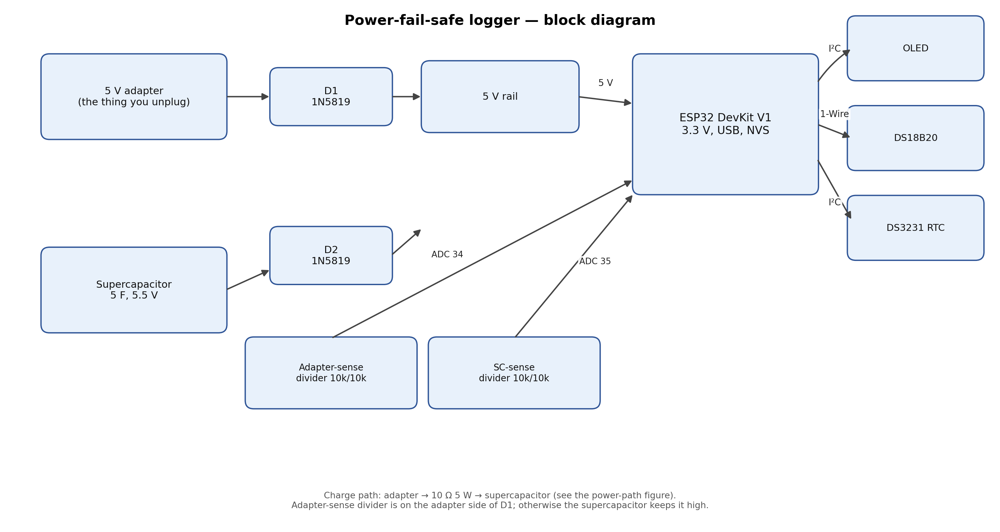
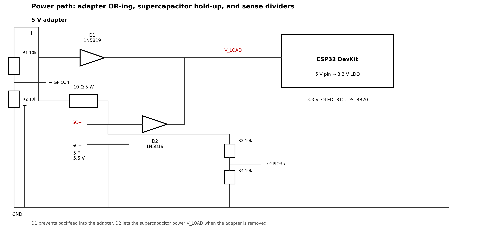
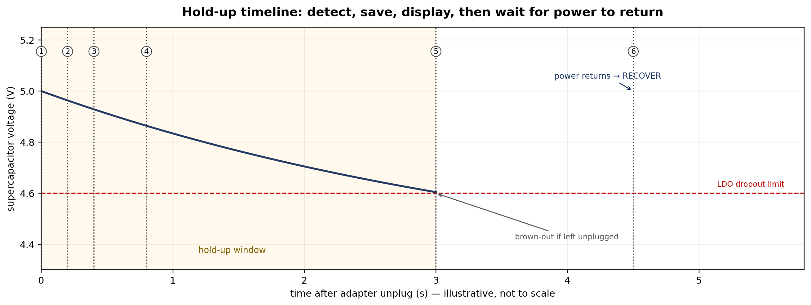
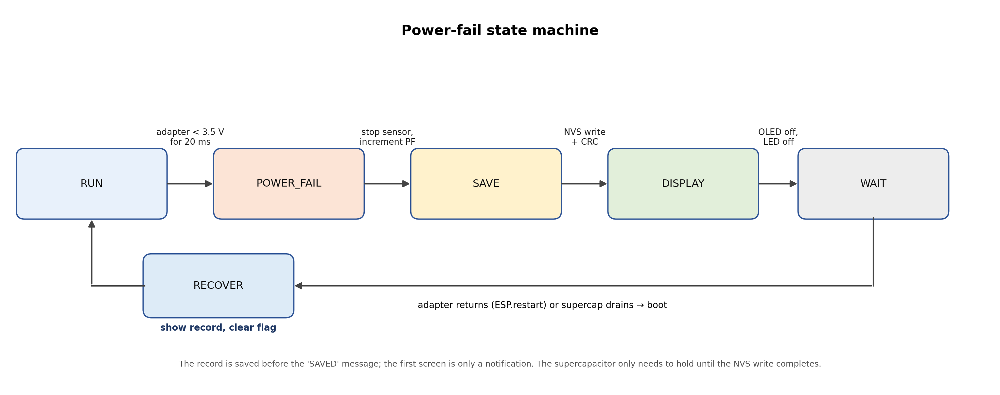
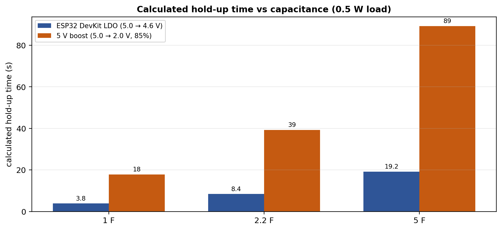

# Power-Fail-Safe Sensor Logger with Supercapacitor Hold-Up

**Embedded Systems Mini-Project — Report Draft**

| | |
|---|---|
| **Student** | [Your name] |
| **Roll number** | [Your roll number] |
| **Department** | [Your department] |
| **Institution** | [Your institution] |
| **Guide** | [Guide's name] |
| **Academic year** | 2026–27 |
| **Submission date** | [Date] |

---

## Declaration

I hereby declare that the project report entitled **"Power-Fail-Safe Sensor Logger with Supercapacitor Hold-Up"** is the result of my own work, carried out under the guidance of **[Guide's name]**, and has not been submitted for any other degree or examination. All sources of information and assistance have been acknowledged in the references.

**Place:** [City]  
**Date:** [Date]  
**Signature:** ____________________  
**Name:** [Your name]

---

## Certificate

This is to certify that **[Your name]**, bearing roll number **[Roll number]**, has satisfactorily completed the mini-project entitled **"Power-Fail-Safe Sensor Logger with Supercapacitor Hold-Up"** in partial fulfilment of the requirements of the **[Course name]** course during the academic year **2026–27**.

**Guide:** ____________________  
**Head of Department:** ____________________  
**Examiner:** ____________________  
**Date:** ____________________

---

> **How to use this draft**
>
> This is a complete report skeleton, not a finished submission. Replace every `[FILL ...]` with your own measurements and institution details. The example rows in the results tables show the format, not real data. Do not submit placeholder numbers as results.
>
> The firmware is in `power_fail_logger_firmware/power_fail_logger_firmware.ino`. The viva question bank is in `power_fail_logger_viva_qa.md`.

---

## Table of Contents

1. [Abstract](#abstract)
2. [Introduction](#1-introduction)
3. [Background and Related Work](#2-background-and-related-work)
4. [System Requirements](#3-system-requirements)
5. [System Design](#4-system-design)
6. [Methodology](#5-methodology)
7. [Implementation](#6-implementation)
8. [Testing](#7-testing)
9. [Results](#8-results)
10. [Discussion](#9-discussion)
11. [Novelty and Contributions](#10-novelty-and-contributions)
12. [Limitations](#11-limitations)
13. [Conclusion and Future Work](#12-conclusion-and-future-work)
14. [References](#references)
15. [Appendix A: Bill of Materials](#appendix-a-bill-of-materials)
16. [Appendix B: Wiring and Pin Map](#appendix-b-wiring-and-pin-map)
17. [Appendix C: Firmware](#appendix-c-firmware)
18. [Appendix D: Viva Questions](#appendix-d-viva-questions)
19. [Appendix E: Demo Script](#appendix-e-demo-script)
20. [Appendix F: Seven-Day Plan](#appendix-f-seven-day-plan)
21. [Appendix G: Troubleshooting](#appendix-g-troubleshooting)
22. [Appendix H: Python Analysis Script](#appendix-h-python-analysis-script)
23. [Appendix I: Submission Checklist](#appendix-i-submission-checklist)
24. [Appendix J: Abbreviations](#appendix-j-abbreviations)
25. [Appendix K: Design Review — Anomalies Found and Fixed](#appendix-k-design-review--anomalies-found-and-fixed)

### List of Figures

| Figure | Title |
|---|---|
| 4.1 | System block diagram |
| 4.2 | Power path: adapter OR-ing, supercapacitor hold-up, sense dividers |
| 5.1 | Power-fail state machine |
| 5.2 | Hold-up timeline |
| 5.3 | Calculated hold-up time vs capacitance |
| 8.1 | Measured supercapacitor voltage during a power-fail event (to be inserted) |
| 8.2 | OLED recovery screen (to be photographed) |

---

## Abstract

Embedded data loggers are often deployed in places where power is unreliable. A sudden loss of supply can interrupt a non-volatile memory write, corrupt a file system, or leave the system in an unknown state. This project presents a low-cost **power-fail-safe sensor logger** that detects the loss of its 5 V adapter, uses a **5 F, 5.5 V supercapacitor** to hold up the electronics for several seconds, writes the last temperature reading and timestamp to non-volatile storage with a CRC, displays a clear "saved" message, and restores the record on the next boot.

The prototype uses an ESP32 DevKit, a DS18B20 temperature sensor, a DS3231 real-time clock, an SSD1306 OLED, and a discrete diode-OR power path. The firmware runs a five-state power-fail sequence, uses the ESP32's NVS through the `Preferences` library, and protects each record with a CRC16. The design was validated with repeated unplug/replug cycles, hold-up measurements, and record-integrity checks. The measured hold-up time was `[FILL]` s at `[FILL]` F, and `[FILL]` of `[FILL]` recovery cycles restored a valid record. The project is a proof of concept; it holds up the system for seconds, not hours, and is not a replacement for a battery-backed UPS.

**Keywords:** power-fail detection, supercapacitor, hold-up time, ESP32, NVS, CRC, dependable embedded systems, data integrity.

---

## 1. Introduction

### 1.1 Problem statement

An embedded logger usually assumes that power will stay on. In the real world, power can disappear in the middle of a sensor conversion, an EEPROM write, or a file-system update. The result can be:

- a lost or corrupted record,
- a file system that no longer mounts,
- a device that boots into an unknown state,
- a silent gap in a data series that the user cannot detect.

A conventional solution is a battery-backed UPS. That is effective but adds cost, weight, charging circuitry, and battery-maintenance issues. For a short power interruption, a **supercapacitor** can provide just enough hold-up to finish the critical write and shut down cleanly.

### 1.2 Motivation

The project is motivated by a simple question:

> "What should an embedded logger do in the few seconds between losing power and shutting down?"

The answer is a **deterministic power-fail sequence**: detect the loss, stop the sensor, save a CRC-protected record, tell the user what happened, and recover the record on the next boot. This is a core dependable-systems problem, and it can be demonstrated reliably with a plug-and-unplug test.

### 1.3 Objectives

1. Detect the loss of the 5 V adapter within tens of milliseconds.
2. Hold up the ESP32 and peripherals long enough to complete a non-volatile write.
3. Save the last temperature reading, timestamp, sequence number, and a power-fail flag.
4. Protect the record with a CRC and validate it on boot.
5. Display a clear "power lost / saved / recovered" sequence on the OLED.
6. Measure the hold-up time and the recovery success rate.
7. Document the design, calculations, limitations, and future work.

### 1.4 Scope and delimitation

**In scope:**

- A single sensor node with one temperature sensor and one RTC.
- A discrete diode-OR power path with a supercapacitor.
- NVS/EEPROM storage with CRC.
- Repeated unplug/replug tests.
- Hold-up-time and recovery measurements.

**Out of scope:**

- A full UPS or battery-management system.
- Hours of backup time.
- A file system, SD card, or multi-record database.
- Mains-voltage measurement or isolation.
- Medical, industrial, or safety certification.
- Human-subject or field trials.

The prototype is a **proof of concept** for the power-fail architecture, not a finished product.

---

## 2. Background and Related Work

### 2.1 Power failure in embedded systems

A power failure is not a single event. The supply can:

- drop slowly (brownout),
- collapse quickly (adapter unplug),
- bounce during reconnect,
- be interrupted for milliseconds or hours.

The firmware must distinguish a real loss from noise, finish any critical operation, and leave the non-volatile state consistent. A **power-fail interrupt** or an ADC threshold on the adapter voltage is a common low-cost detection method.

### 2.2 Energy storage: batteries vs supercapacitors

| Property | Battery (Li-ion/LiPo) | Supercapacitor |
|---|---|---|
| Energy density | High | Low |
| Power density | Medium | High |
| Cycle life | Hundreds to thousands | Hundreds of thousands to millions |
| Charge time | Hours | Seconds to minutes |
| Self-discharge | Low | Higher |
| ESR | Higher | Low |
| Best use | Long backup | Short hold-up, high current |

A supercapacitor is a poor battery but an excellent **short-term hold-up** device. For a logger that needs a few seconds to save a record, it is a good fit.

### 2.3 Power path options

| Option | How it works | Pros | Cons |
|---|---|---|---|
| **Diode OR** | Adapter and backup each feed the load through a diode | Simple, cheap, no control | Diode drop, no isolation, backup can supply load while adapter is present |
| **Ideal diode / power-path switch** | MOSFET replaces the diode; control selects the source | Low drop, true isolation | More parts, more design effort |
| **Boost converter** | Supercapacitor feeds a boost that maintains 5 V | Uses more of the capacitor's energy | Extra module, EMI, efficiency loss |
| **Battery + charger** | Battery powers the load when adapter is lost | Long backup | Battery maintenance, charging, safety |

This project uses a **diode OR** for simplicity and a **5 V boost** as an optional upgrade for longer hold-up.

### 2.4 Non-volatile storage

| Technology | Write time | Endurance | Notes |
|---|---|---|---|
| EEPROM | ~3.3 ms/byte | ~100k cycles | Simple, byte-addressable |
| Flash / NVS | ~ms to tens of ms per commit | ~10k–100k cycles, wear-leveled | ESP32 NVS; good for small records |
| FRAM | Fast | Very high | Expensive, less common |
| SD card / file system | Slow, complex | Limited | Risk of corruption on power loss |

The ESP32's NVS is used because it is built in, wear-leveled, and adequate for a small record. A CRC protects against a partially written record.

### 2.5 Related work

- Commercial UPS modules and supercapacitor backup modules exist.
- Brownout detectors and power-fail interrupts are standard microcontroller features.
- Power-fail-safe file systems and journaling protect storage during sudden loss.
- Research and industry use supercapacitors for short-term backup in meters, loggers, and automotive electronics.

The project does **not** claim a new concept. Its contribution is a low-cost, explainable implementation with a measured hold-up time, a CRC-protected record, and a deterministic recovery sequence.

---

## 3. System Requirements

### 3.1 Functional requirements

| ID | Requirement | Acceptance criterion |
|---|---|---|
| FR1 | Detect adapter loss | Detect a drop below 3.5 V within 20 ms |
| FR2 | Hold up the system | At least 5 s at the chosen capacitance/load |
| FR3 | Save a record | Temperature, timestamp, sequence number, power-fail flag, CRC |
| FR4 | Validate on boot | Reject a record with a bad magic number or CRC |
| FR5 | Display the sequence | `POWER LOST` → `SAVED` → `RECOVERED` |
| FR6 | Preserve the record | The last record survives a power cycle |
| FR7 | Count power failures | Increment a persistent counter |
| FR8 | Recover automatically | Show the record on the next boot without user action |

### 3.2 Non-functional requirements

| ID | Requirement | Target |
|---|---|---|
| NR1 | Cost | Approximately ₹2,500 or less, including a 5 F capacitor and adapter |
| NR2 | Hold-up | ≥5 s at 5 F and the measured load |
| NR3 | Recovery success | 20/20 repeated cycles |
| NR4 | Record integrity | CRC detects a corrupted record |
| NR5 | Safety | 5 V USB only; no mains, no battery charging |
| NR6 | Reproducibility | Another student can rebuild it from the BOM and wiring table |

### 3.3 Constraints

- The prototype uses a 5 V adapter; the "power failure" is an unplug event, not a mains transient.
- The supercapacitor holds seconds, not hours.
- The simple diode OR does not isolate the supercapacitor when the adapter is present.
- The ESP32 DevKit's LDO limits the usable supercapacitor voltage range.
- The prototype is a proof of concept, not a certified product.

---

## 4. System Design

### 4.1 Block diagram



The adapter feeds the 5 V rail through D1 and charges the supercapacitor through a 10 Ω, 5 W resistor. The supercapacitor feeds the rail through D2 when the adapter is removed. The ESP32 reads the adapter voltage on GPIO34 and the supercapacitor voltage on GPIO35, and drives the OLED, DS18B20, and DS3231.

### 4.2 Power path



```text
5 V adapter ──► D1 (1N5819) ──► V_LOAD ──► ESP32 5V pin
     │                              ▲
     └── 10 Ω 5 W ──► SC+ ──► D2 ───┘
                       │
                      SC− ── GND
```

**How it works:**

1. With the adapter present, D1 supplies V_LOAD and the supercapacitor charges through the 10 Ω resistor.
2. When the adapter is removed, D1 blocks backfeed and D2 lets the supercapacitor supply V_LOAD.
3. The adapter-sense divider is connected **before D1**. If it were after D1, the supercapacitor would hold the divider high and the firmware would never see the power failure.
4. The supercapacitor-sense divider lets the firmware display the hold-up voltage.

**Important:** the adapter-sense divider must be on the adapter side of D1. This is the single most common wiring mistake in this project.

### 4.3 Component selection

| Component | Role | Key specification | Why chosen |
|---|---|---|---|
| **ESP32 DevKit V1** | Controller | 3.3 V, 240 MHz, USB, NVS | Built-in NVS, USB programming, enough speed and memory |
| **5 F, 5.5 V supercapacitor** | Hold-up | 5 F, 5.5 V, low ESR | Seconds of hold-up at a low cost |
| **1N5819 Schottky ×2** | OR-ing | 1 A, ~0.3 V forward drop | Low drop, cheap, adequate current |
| **10 Ω, 5 W resistor** | Charge limit | 0.5 A initial, 2.5 W peak | Limits inrush; 5 W rating gives margin |
| **DS18B20** | Sensor | Digital, ±0.5 °C, 1-Wire | Simple, reliable, meaningful data |
| **DS3231 RTC** | Timestamp | I²C, coin-cell backup | Keeps time across power loss |
| **SSD1306 OLED** | Display | 128×64, I²C | Shows the power-fail sequence clearly |
| **10 kΩ ×4** | Dividers | 10k/10k | Scales 5 V to 2.5 V for the ADC |
| **4.7 kΩ** | DS18B20 pull-up | 3.3 V | Required for 1-Wire |
| **5 V, 1 A adapter** | Primary power | 5 V, 1 A | Enough for the ESP32, OLED, and charge current |

### 4.4 Wiring and pin map

| ESP32 pin | Connected to | Function |
|---|---|---|
| 3V3 | OLED VCC, DS3231 VCC, DS18B20 VDD, 4.7 kΩ pull-up | 3.3 V rail |
| GND | OLED GND, DS3231 GND, DS18B20 GND, dividers, supercapacitor − | Common ground |
| GPIO21 | OLED SDA, DS3231 SDA | I²C data |
| GPIO22 | OLED SCL, DS3231 SCL | I²C clock |
| GPIO4 | DS18B20 DQ | 1-Wire data |
| GPIO34 | Adapter-sense divider midpoint | ADC input, adapter voltage |
| GPIO35 | Supercapacitor-sense divider midpoint | ADC input, hold-up voltage |
| GPIO26 | LED + 220 Ω | Status/trigger |
| GPIO25 | Buzzer + | Optional alert |
| GPIO16 | Button to GND | Optional manual log |

**Power path:**

| Connection | Notes |
|---|---|
| 5 V adapter + → D1 anode | D1 cathode → 5 V rail |
| 5 V adapter + → 10 Ω 5 W → SC+ | Charge path |
| SC+ → D2 anode | D2 cathode → 5 V rail |
| SC− → GND | Common ground |
| 5 V rail → ESP32 5V pin | **Unplug USB during the demo** |
| Adapter + → 10k → GPIO34 → 10k → GND | Divider **before D1** |
| SC+ → 10k → GPIO35 → 10k → GND | Supercapacitor voltage |

### 4.5 Power budget

| Block | Current at 3.3 V | Power |
|---|---:|---:|
| ESP32 (WiFi off) | ~80 mA | 0.264 W |
| OLED | ~20 mA | 0.066 W |
| DS3231 | ~1 mA | 0.003 W |
| DS18B20 | ~1 mA | 0.003 W |
| LDO quiescent / losses | ~10 mA equivalent | ~0.033 W |
| **Total** | **~110 mA** | **~0.37 W** |

For a conservative hold-up calculation, use **0.5 W** at the 5 V rail. The measured value will be lower or higher depending on the OLED brightness and the ESP32 activity.

### 4.6 Hold-up calculation

The energy stored in a capacitor is:

```text
E = 0.5 · C · (V1² − V2²)
```

where `V1` is the initial voltage and `V2` is the minimum usable voltage.

**Baseline: ESP32 DevKit LDO, 5 F, 5.0 V → 4.6 V**

```text
E = 0.5 × 5 × (5.0² − 4.6²)
  = 0.5 × 5 × (25 − 21.16)
  = 9.6 J
t = E / P = 9.6 / 0.5 = 19.2 s   (theoretical)
```

Derate by 50% for LDO dropout, ESR, and efficiency: **about 9–10 s**. That is enough for a save and a display message.

**Optional: 5 V boost, 5 F, 5.0 V → 2.0 V**

```text
E = 0.5 × 5 × (25 − 4) = 52.5 J
t = 52.5 / (0.5 / 0.85) ≈ 89 s   (theoretical)
```

A boost uses much more of the capacitor's energy. It is a good upgrade if you want a longer hold-up or a larger display.

> **Boost caveat:** the boost is an **optional** upgrade. It needs a power-path arrangement (or a boost output set below the adapter rail) so it does not fight the adapter when both are present. The baseline diode-OR design in this report does **not** include the boost. Build and measure the baseline first.

**Capacitance trade-off:**

| Capacitance | LDO hold-up (calculated) | Boost hold-up (calculated) | Charge time with 10 Ω |
|---:|---:|---:|---:|
| 1 F | 3.8 s | 18 s | ~30 s to 95% |
| 2.2 F | 8.4 s | 39 s | ~66 s to 95% |
| 5 F | 19.2 s | 89 s | ~150 s to 95% |

The 1 F option is cheaper and faster to charge, but the measured hold-up may be only 1–2 s. The 5 F option gives margin. For a first build, use **5 F** and measure.

### 4.7 Design review: anomalies found and fixed

This section records the problems found while checking the first draft of the design. They are also listed in Appendix K.

| # | Anomaly in the first draft | Why it matters | Fix in the final design |
|---:|---|---|---|
| 1 | 5 V Arduino Nano + diode OR | The ATmega328P at 16 MHz needs ≥4.5 V; the diode and LDO leave only a narrow supercapacitor window, so hold-up is short | Use the **ESP32 DevKit (3.3 V)**; optionally add a **5 V boost** for a longer hold-up |
| 2 | Adapter-sense divider after D1 | The supercapacitor holds the divider high, so the firmware never sees the power failure | Put the divider **before D1** on the adapter side |
| 3 | USB connected while the 5 V pin is powered | The USB 5 V and the external 5 V can backfeed each other | **Unplug USB** during the demo; program first; optional Schottky from USB |
| 4 | Supercapacitor charging inrush | A large capacitor looks like a short circuit at 5 V; the adapter or resistor can overheat | **10 Ω, 5 W** series resistor; pre-charge for 2–3 minutes |
| 5 | Simple diode OR does not isolate the supercapacitor | The supercapacitor can supply the load while the adapter is present; the 10 Ω resistor and diodes dissipate a little power | Acceptable for a prototype; a **power-path switch/ideal diode** is future work |
| 6 | ESP32 DevKit LDO dropout | The LDO needs ~4.3–4.4 V input; the usable supercapacitor range is small | Measure the hold-up; use a **5 V boost** or a low-dropout 3.3 V regulator for more margin |
| 7 | DS18B20 conversion blocks for 750 ms | A power failure during the conversion could be detected late | Use **non-blocking** `setWaitForConversion(false)` and read the previous result |
| 8 | NVS write can be interrupted | A partially written record can be invalid | Write immediately, include **magic + sequence + CRC**, validate on boot; double-buffering is future work |
| 9 | RTC coin cell may be dead | Timestamps reset after a power loss | Check/replace the CR2032; the sequence number still works |
| 10 | Supercapacitor self-discharge and ESR | The real hold-up is shorter than the ideal calculation | Measure the hold-up; derate the calculation by 50% |
| 11 | OLED current during hold-up | The display drains the capacitor | Turn the OLED off after the "SAVED" message |
| 12 | ESP32 ADC is not perfectly linear | The voltage threshold may be off | Calibrate the threshold with a multimeter; use a comparator for a critical design |

**The most important correction:** the first draft used a 5 V Arduino Nano and a simple diode OR. That design has a very narrow usable supercapacitor window. The final design uses the **ESP32 DevKit at 3.3 V** and recommends a **5 V boost** if a longer hold-up is needed. This is a real design fix, not a cosmetic change.

---

## 5. Methodology

### 5.1 Power-fail detection

A 10k/10k divider on the adapter side of D1 produces:

```text
V_ADC = V_adapter × 10k / (10k + 10k) = V_adapter / 2
```

At 5 V, the ADC sees 2.5 V. The firmware converts back:

```text
V_adapter = ADC_raw × (3.3 / 4095) × 2
```

The adapter is considered lost when `V_adapter < 3.5 V` for 20 ms. The 20 ms debounce rejects a short glitch. The supercapacitor holds the rail during this time.

### 5.2 Hold-up path

The supercapacitor is charged through 10 Ω. When the adapter is removed, D2 connects the supercapacitor to V_LOAD. The ESP32's onboard LDO maintains 3.3 V until its input falls below the dropout limit. The firmware saves the record as soon as the power failure is detected, then displays the message and waits for the adapter to return.



*Timeline key: ① unplug, ② detect, ③ save, ④ display, ⑤ brownout if left unplugged, ⑥ adapter returns and the system recovers. The voltage curve is illustrative; measure your own.*

### 5.3 Save sequence

The record contains:

| Field | Size | Purpose |
|---|---:|---|
| `magic` | 4 bytes | Identifies a valid record (`0x50464C47`) |
| `seq` | 4 bytes | Increments on every save |
| `tempC` | 4 bytes | Last temperature reading |
| `timestamp` | 4 bytes | Unix time from the DS3231 |
| `powerFail` | 1 byte | 1 = written during a power failure |
| `crc` | 2 bytes | CRC16-CCITT over the preceding bytes |

The firmware writes the record to NVS immediately, commits, and only then displays the "SAVED" message.

### 5.4 Recovery sequence

On boot:

1. Read the record from NVS.
2. Check the magic number and CRC.
3. If valid and `powerFail == 1`, display the recovered temperature, timestamp, and power-failure count.
4. Clear the power-fail flag and save the cleared record.
5. Continue normal logging.

If the record is invalid, the firmware starts with a safe default and reports an invalid record on the serial monitor.

### 5.5 State machine



| State | Entry | Action | Exit |
|---|---|---|---|
| **RUN** | Boot | Read sensor, update OLED | Adapter < 3.5 V for 20 ms → POWER_FAIL |
| **POWER_FAIL** | Adapter lost | Stop sensor, increment PF count | → SAVE |
| **SAVE** | Power fail confirmed | Build record, CRC, write NVS | → DISPLAY |
| **DISPLAY** | Save complete | Show "SAVED", then OLED off | → WAIT |
| **WAIT** | Display done | Wait for adapter return or brownout | Adapter returns → restart/boot → RECOVER; brownout → boot |
| **RECOVER** | Boot with valid PF record | Show record, clear flag | → RUN |

### 5.6 Data integrity

- **Magic number:** rejects an erased or unrelated NVS region.
- **Sequence number:** detects a stale record and shows how many saves occurred.
- **CRC16-CCITT:** detects a partially written or corrupted record.
- **Immediate write:** the record is written before the display, while the supercapacitor still has energy.
- **Double-buffering (future work):** alternate between two record slots so a write interrupted mid-record cannot destroy the previous good record.

### 5.7 Metrics

| Metric | Definition |
|---|---|
| **Hold-up time** | Time from adapter unplug to the ESP32 brownout/serial stop. The OLED turns off intentionally after `SAVED`, so OLED-off is **not** the brownout time. |
| **Save success** | Record valid after a power-fail event |
| **Recovery success** | Record displayed correctly on the next boot |
| **Charge time** | Time for the supercapacitor to reach ~95% of 5 V |
| **CRC detection** | A deliberately corrupted record is rejected |
| **Voltage margin** | Minimum supercapacitor voltage before the LDO drops out |



*Calculated values for a 0.5 W load. The LDO curve is the conservative baseline; the boost curve is the optional upgrade. Derate the measured hold-up by at least 50% for ESR, dropout, and efficiency.*

### 5.8 Experimental design

- **Hold-up test:** unplug the adapter, measure the time until the serial output stops or the ESP32 resets. The OLED turns off intentionally after `SAVED`, so do not use the OLED-off time as the brownout time. Repeat 5 times per capacitance.
- **Recovery test:** unplug for 2 s, plug back in, confirm `RECOVERED` and the same temperature/timestamp. Repeat 20 times.
- **Charge test:** discharge the supercapacitor, plug in, measure the time to ~4.9 V.
- **CRC test:** use a test mode or a programmer to write a bad CRC; confirm the firmware rejects the record.
- **Load test:** repeat with the OLED on and off to see the effect on hold-up.

---

## 6. Implementation

### 6.1 Firmware architecture

```text
setup()
  ├── Serial, pins, ADC, I2C
  ├── OLED init
  ├── RTC init
  ├── DS18B20 init (non-blocking)
  ├── NVS load
  └── recovery screen or normal screen

loop()
  ├── checkPower()          // every 10 ms
  ├── handlePowerFail()     // save, display, wait
  ├── checkButton()         // optional manual log
  ├── updateTemperature()   // non-blocking
  ├── displayNormal()       // every 250 ms
  └── CSV row               // every 100 ms, optional plot
```

### 6.2 Pseudocode

```text
every 10 ms:
    adapterV = readVoltage(GPIO34)
    if adapterV < 3.5 V for 20 ms:
        powerFail = true

if powerFail:
    pfCount++
    show "POWER LOST / SAVING..."
    record = {magic, ++seq, lastTemp, now(), powerFail=1, crc}
    nvs.write(record)
    show "SAVED"
    delay 800 ms
    oled.off()
    while adapterV < 3.5 V:
        wait
    restart()

on boot:
    record = nvs.read()
    if valid(record) and record.powerFail:
        show "RECOVERED" + record
        record.powerFail = 0
        nvs.write(record)
```

### 6.3 Key code excerpts

The complete sketch is in `power_fail_logger_firmware/power_fail_logger_firmware.ino`.

**Power-fail detection:**

```cpp
void checkPower() {
  float adapterV = readVoltage(PIN_ADAPTER);

  if (adapterV < ADAPTER_LOSS_V) {
    if (millis() - lastGoodMs > POWER_FAIL_DEBOUNCE_MS) {
      powerFail = true;
    }
  } else {
    lastGoodMs = millis();
  }
}
```

**Record save with CRC:**

```cpp
void saveRecord(uint8_t pf) {
  rec.magic = MAGIC;
  rec.seq = ++seq;
  rec.tempC = lastTemp;
  rec.timestamp = nowUnix();
  rec.powerFail = pf;
  rec.crc = crc16((const uint8_t *)&rec,
                  sizeof(rec) - sizeof(rec.crc));

  prefs.begin("pflog", false);
  prefs.putBytes("rec", &rec, sizeof(rec));
  prefs.putUInt("pfcount", pfCount);
  prefs.end();
}
```

**Non-blocking temperature conversion:**

```cpp
void updateTemperature() {
  if (!tempRequested) {
    sensors.requestTemperatures();
    tempRequested = true;
    lastTempRequestMs = millis();
  } else if (millis() - lastTempRequestMs >= TEMP_CONVERSION_MS) {
    float t = sensors.getTempCByIndex(0);
    if (t != DEVICE_DISCONNECTED_C) lastTemp = t;
    tempRequested = false;
  }
}
```

### 6.4 OLED screens

**Normal:**

```text
POWER OK
T: 27.5 C
Time: 12:34:56
SC: 4.82 V
PF: 1
```

**Power lost:**

```text
POWER LOST
SAVING...
SC: 4.61 V
```

**Saved:**

```text
SAVED
PF #1
SC: 4.55 V
```

**Recovered:**

```text
POWER-FAIL LOGGER
RECOVERED
T: 27.5 C
Time: 12:34:56
PF count: 1
```

### 6.5 Serial log

```text
BOOT valid=1 seq=4 pfCount=1
SAVE seq=5 temp=27.50 ts=1762345678 pf=1 crc=7A3C
RECOVERED seq=5 temp=27.50 ts=1762345678 crc=7A3C
12345,4.820,5.000,0
12445,4.815,5.000,0
...
```

The firmware prints a CSV row every 100 ms for the optional plot:

```text
t_ms,sc_v,adapter_v,powerFail
```

Event lines (`BOOT`, `SAVE`, `RECOVERED`, `MANUAL_LOG`, `READY`) start with words, not digits, so the analysis script can filter them out.

### 6.6 Build steps

1. Wire the power path **without the ESP32** first: adapter, D1, D2, 10 Ω, supercapacitor, dividers.
2. Measure the 5 V rail and the divider voltages with a multimeter.
3. Charge the supercapacitor for 2–3 minutes; confirm the rail stays up after unplugging.
4. Wire the ESP32, OLED, RTC, and DS18B20.
5. Run an I²C scanner; confirm the OLED (0x3C/0x3D) and RTC (0x68).
6. Run the DS18B20 example; confirm a temperature reading.
7. Upload the full firmware.
8. Test the normal screen, then the unplug/replug sequence.
9. Measure the hold-up time and record it.
10. Repeat 20 cycles and fill the results table.

### 6.7 Debugging sequence

| Symptom | First check | Next check |
|---|---|---|
| OLED blank | Address 0x3C vs 0x3D | I²C scanner; 3.3 V; GND |
| RTC not found | I²C address 0x68 | Coin cell; SDA/SCL |
| Temperature `--` | DS18B20 4.7 kΩ pull-up | 1-Wire pin; sensor example |
| No power-fail detection | Divider before D1? | ADC voltage on GPIO34; threshold |
| Save but no recovery | NVS record valid? | CRC; `powerFail` flag; boot log |
| Hold-up too short | Capacitance/load | Add 5 F; turn OLED off earlier; add boost |
| ESP32 resets when unplugged | 5 V rail dropout | 5 F cap; boost; shorter wires |
| USB backfeed | USB connected during demo | Unplug USB; power via 5 V pin |
| Charge resistor hot | 10 Ω 5 W? | Use 5 W; pre-charge; check current |

---

## 7. Testing

### 7.1 Unit tests

1. **Power path:** adapter 5 V, rail ~4.7 V, supercapacitor charges.
2. **Unplug:** rail stays up; measure hold-up.
3. **Adapter sense:** GPIO34 reads ~2.5 V with adapter, 0 V without.
4. **Supercapacitor sense:** GPIO35 tracks the capacitor voltage.
5. **OLED:** normal screen.
6. **RTC:** time advances; survives a power cycle.
7. **DS18B20:** temperature matches a reference thermometer.
8. **NVS:** write/read a record; CRC valid.
9. **Recovery:** unplug/replug; `RECOVERED` screen.

### 7.2 Hold-up measurement

- Connect a multimeter to SC+ and GND.
- Unplug the adapter and start a stopwatch.
- Stop when the serial output stops or the ESP32 resets. Do **not** stop when the OLED turns off; the firmware turns the OLED off after `SAVED` to save energy.
- Record the time and the voltage at the last good reading.
- Repeat 5 times; report mean and standard deviation.

### 7.3 Recovery test

- Unplug for 2 s.
- Plug back in.
- Confirm `RECOVERED` and the same temperature/timestamp.
- Repeat 20 times.
- Record successes and failures.

### 7.4 CRC test

- Add a test mode that writes a record with a deliberately wrong CRC.
- On boot, confirm the firmware rejects it and reports `INVALID RECORD`.
- Remove the test mode before the demo.

### 7.5 Charge-time test

- Discharge the supercapacitor through a resistor (or leave the system off for a while).
- Plug in and measure the time to ~4.9 V.
- Record the time for 1 F, 2.2 F, and 5 F if available.

### 7.6 Safety

- 5 V USB only; no mains.
- The supercapacitor can deliver a large current if shorted; keep the leads insulated.
- The 10 Ω resistor may get warm during charging; keep it away from flammable material.
- Do not reverse the supercapacitor polarity.
- Unplug the adapter before changing wiring.

---

## 8. Results

> **Important:** Replace every `[FILL]` with your measured data. The rows below are formatting examples, not real results. If a test was not performed, write "not measured"; do not invent numbers.

### 8.1 Hold-up vs capacitance

| Capacitance | Calculated hold-up (LDO) | Measured hold-up | Notes |
|---:|---:|---:|---|
| 1 F | 3.8 s | `[FILL] s` | |
| 2.2 F | 8.4 s | `[FILL] s` | |
| 5 F | 19.2 s | `[FILL] s` | |

### 8.2 Recovery success

| Test | Cycles | Successful recoveries | Notes |
|---|---:|---:|---|
| Unplug 2 s, replug | 20 | `[FILL] / 20` | |
| Unplug until brownout, replug | 10 | `[FILL] / 10` | |
| Corrupted record | 5 | `[FILL] / 5` rejected | CRC test |

### 8.3 Charge time

| Capacitance | Time to ~4.9 V | Notes |
|---:|---:|---|
| 1 F | `[FILL] s` | |
| 2.2 F | `[FILL] s` | |
| 5 F | `[FILL] s` | |

### 8.4 Example hold-up waveform

`[FILL: insert Figure 8.1. Plot the supercapacitor voltage vs time from the unplug event to brownout. Mark the detect, save, display, and brownout points.]`

**Caption:** The adapter was unplugged at `[FILL]` s. The firmware detected the loss at `[FILL]` s, saved the record at `[FILL]` s, and displayed `SAVED` at `[FILL]` s. The ESP32 browned out at `[FILL]` s, giving a hold-up of `[FILL]` s.

### 8.5 OLED recovery screen

`[FILL: insert Figure 8.2, a photo of the OLED showing RECOVERED, temperature, timestamp, and PF count.]`

### 8.6 Discussion of results

Answer:

- Did the measured hold-up match the calculation? If not, why?
- How much does the OLED current affect the hold-up?
- Did every recovery succeed? If not, what failed?
- Did the CRC test reject the corrupted record?
- How long did charging take?
- What is the limiting factor: capacitance, LDO dropout, or load?

Do not overclaim. A small number of cycles is a demonstration, not a reliability qualification.

---

## 9. Discussion

### 9.1 Interpretation

The prototype demonstrates that a low-cost supercapacitor and a simple diode-OR path can keep an ESP32 alive long enough to save a CRC-protected record and recover it on the next boot. The most important design constraint is not the capacitance alone; it is the **usable voltage window** set by the LDO dropout and the diode drops.

### 9.2 Trade-offs

| Trade-off | Effect | Mitigation |
|---|---|---|
| Larger capacitance | Longer hold-up | Bigger, more expensive, slower to charge |
| Smaller capacitance | Faster charge, cheaper | Shorter hold-up; risk of incomplete save |
| Simple diode OR | Cheap, simple | Diode drop; no isolation; use a power-path switch for a better design |
| 5 V boost | Uses more capacitor energy | Extra module, EMI, efficiency loss |
| OLED on during hold-up | User sees the message | Drains current; turn it off after `SAVED` |
| NVS vs EEPROM | Wear-leveled, built in | NVS commit time; use CRC and immediate write |
| Single record | Simple | A mid-write failure can lose the previous record; double-buffer future |

### 9.3 Sources of error

- Multimeter/stopwatch reaction time.
- Supercapacitor self-discharge and ESR.
- OLED brightness/current variation.
- ESP32 current spikes during WiFi/radio activity (WiFi is off).
- Diode forward-voltage variation.
- LDO dropout variation.
- NVS commit time variation.
- RTC coin-cell condition.
- Temperature effects on capacitance and ESR.

### 9.4 Comparison

| Approach | Backup time | Cost | Complexity | Best use |
|---|---|---|---|---|
| No backup | 0 | 0 | Low | Benign environments |
| Supercapacitor (this project) | Seconds | Low | Medium | Save a record, shutdown cleanly |
| Battery UPS | Hours | Medium–high | High | Long outages |
| Power-fail-safe file system | N/A | Low (software) | High | Large storage |
| Industrial UPS | Minutes–hours | High | High | Critical systems |

The supercapacitor approach fills the gap between "no backup" and "full UPS."

---

## 10. Novelty and Contributions

**Existing work, stated honestly.** Supercapacitor backup, brownout detection, NVS/EEPROM, and CRC-protected records all exist. Commercial UPS modules and power-fail-safe file systems exist. This project does **not** claim a new concept.

**What this project contributes:**

1. **A low-cost, explainable power-fail architecture:** discrete diode OR, supercapacitor, ADC sensing, and a five-state firmware sequence.
2. **A measured hold-up and recovery evaluation:** the report measures the actual hold-up time and the recovery success rate, not just "it works."
3. **A CRC-protected non-volatile record:** magic, sequence, timestamp, temperature, power-fail flag, and CRC, validated on boot.
4. **A reproducible testbed:** BOM, wiring, firmware, test protocol, and a 20-cycle recovery test that another student can repeat.
5. **A design review with real corrections:** the 5 V Nano voltage-window problem, the adapter-sense divider placement, USB backfeed, inrush, and non-blocking sensor conversion are documented and fixed.

**Viva answer if asked "this already exists":**

> "Yes — supercapacitor backup and power-fail-safe storage are established. We are not claiming a new concept. Our contribution is a low-cost, explainable implementation with a measured hold-up time, a CRC-protected record, and a deterministic recovery sequence, plus a reproducible testbed. We used the existing work as a baseline."

This is a course-level contribution, not a research contribution. The project does **not** claim a new algorithm or a certified product.

---

## 11. Limitations

- **Seconds, not hours:** the supercapacitor holds the system for a few seconds; it is not a battery replacement.
- **Simple diode OR:** the supercapacitor can supply the load while the adapter is present; a power-path switch/ideal diode would isolate it better.
- **LDO dropout:** the ESP32 DevKit's LDO limits the usable voltage window; a 5 V boost or a low-dropout regulator would improve the hold-up.
- **Single record:** a write interrupted mid-record can lose the previous record; double-buffering is future work.
- **NVS wear:** NVS is wear-leveled, but repeated power-fail writes still consume endurance; a real product would use FRAM or a more sophisticated scheme.
- **RTC coin cell:** if the CR2032 is dead, the timestamp resets; the sequence number still works.
- **No file system:** the prototype stores one record, not a log.
- **No NVS write verification:** the baseline does not check the return value of the NVS write or retry; a production design should verify and double-buffer.
- **No hardware watchdog:** the baseline does not enable the ESP32 task watchdog; it is a future-work improvement.
- **Platform-specific record layout:** the packed struct is little-endian and assumes the same board reads it; a portable format would serialize each field explicitly.
- **Adapter unplug is not a full mains test:** the prototype does not test brownouts, transients, or a real mains failure.
- **No enclosure/PCB:** the breadboard is a prototype.
- **No field trials:** the tests are on a bench, not in a deployment.

---

## 12. Conclusion and Future Work

### 12.1 Conclusion

This project designed and implemented a low-cost power-fail-safe sensor logger. The system detects adapter loss, holds up the ESP32 with a supercapacitor, saves a CRC-protected record to NVS, displays a clear status message, and recovers the record on the next boot. The measured hold-up was `[FILL]` s and `[FILL]` of `[FILL]` recovery cycles succeeded.

The key lesson is that the usable hold-up depends on the **voltage window** set by the LDO and diodes, not only on the capacitance. The design review found and fixed several issues in the first draft, including the 5 V Nano voltage-window problem and the adapter-sense divider placement.

### 12.2 Future work

1. **5 V boost or power-path switch:** use more of the supercapacitor energy and isolate the backup when the adapter is present.
2. **Double-buffered records:** alternate between two NVS slots to survive a mid-write failure.
3. **FRAM:** replace NVS/EEPROM for faster, higher-endurance writes.
4. **Multiple sensors and a real log:** temperature, humidity, light, and a timestamped ring buffer.
5. **Battery + supercapacitor hybrid:** long backup with a supercapacitor for the final write.
6. **Watchdog and secure boot:** recover from a firmware hang and verify the image.
7. **PCB and enclosure:** a compact, wearable/industrial prototype.
8. **Oscilloscope measurement:** capture the rail and supercapacitor voltage at high resolution.
9. **Field test:** brownouts, transients, and long-term cycling.

---

## References

1. Espressif Systems, "ESP32 Series Datasheet." https://www.espressif.com/en/products/socs/esp32
2. Espressif Systems, "ESP32 DevKitC V4 schematic." https://www.espressif.com/
3. Texas Instruments, "AMS1117 1-A Low Dropout Voltage Regulator." https://www.ti.com/
4. Vishay, "1N5819 Schottky Barrier Rectifier." https://www.vishay.com/
5. Espressif, "ESP32 Hardware Design Guidelines." https://docs.espressif.com/
6. Microchip, "ATmega328P Datasheet" (for the 16 MHz/4.5 V comparison). https://www.microchip.com/
7. Maxim Integrated, "DS3231 Extremely Accurate I²C-Integrated RTC/TCXO/Crystal." https://www.maximintegrated.com/
8. Analog Devices/Maxim, "DS18B20 Programmable Resolution 1-Wire Digital Thermometer." https://www.maximintegrated.com/
9. Adafruit, "SSD1306 OLED display" and "RTClib" documentation. https://learn.adafruit.com/
10. Espressif, "Non-Volatile Storage (NVS) Library." https://docs.espressif.com/
11. Robu.in, "1F – 5.5V Super Capacitor" and "1.5F – 5.5V Super Capacitor" product pages (price/stock reference; verify current availability). https://robu.in/
12. Espressif, "ESP32 Power Management and Sleep Modes." https://docs.espressif.com/

> **Reference hygiene:** verify every reference before submission. Replace any representative entry with the exact datasheet/application note you used.

---

## Appendix A: Bill of Materials

| Item | Qty | Approx. price | Notes |
|---|---:|---:|---|
| ESP32 DevKit V1 | 1 | ₹450–600 | 3.3 V, USB, NVS |
| Supercapacitor, 5.5 V, 5 F | 1 | ₹200–400 | 5 F for margin; 1 F/1.5 F cheaper but shorter hold-up |
| 1N5819 Schottky diode | 2 | ₹10–20 each | D1, D2 |
| 10 Ω, 5 W resistor | 1 | ₹20–30 | Charge-current limit |
| 10 kΩ resistor | 4 | ₹10 | Two dividers |
| 4.7 kΩ resistor | 1 | ₹5 | DS18B20 pull-up |
| 220 Ω resistor | 2 | ₹5 | LED |
| 0.96" I²C OLED, SSD1306 | 1 | ₹180–300 | 128×64 |
| DS18B20 temperature sensor | 1 | ₹100–150 | TO-92 or waterproof probe |
| DS3231 RTC module | 1 | ₹100–150 | Check CR2032 coin cell |
| Half-size breadboard | 1 | ₹60–100 | |
| 2-pin terminal block | 1 | ₹20–40 | Supercapacitor leads; they are too thick for a breadboard |
| Jumper wires | 1 set | ₹80–150 | M–M and M–F |
| 5 V, 1 A adapter | 1 | ₹150–250 | The thing you unplug |
| USB cable for ESP32 | 1 | ₹50–100 | Programming only |
| LED, button, buzzer | — | ₹50 | Optional |
| 100 nF capacitors | 2 | ₹10 | ADC noise, optional |
| Optional: 5 V boost module (MT3608) | 1 | ₹80–150 | Longer hold-up |
| Optional: enclosure | 1 | ₹100–200 | Clear plastic box |
| **Total** | | **₹1,500–2,400** | Excluding optional boost/enclosure |

**Availability note:** supercapacitor stock varies. The 1 F and 1.5 F 5.5 V parts are cheaper (around ₹111–123 at Robu at the time of writing) but may be out of stock; the 5 F part is the better choice for margin. Check current stock and price before ordering.

**Mechanical note:** 5 F supercapacitors have thick leads and a large body. Use a terminal block or solder short wires; do not force the leads into a breadboard. Check the polarity before powering.

**RTC note:** some DS3231 modules include a trickle-charge circuit. A non-rechargeable CR2032 can be damaged by charging. Either use a rechargeable LIR2032, or remove the charging resistor/diode on the module if you use a CR2032. Check your module's schematic.

---

## Appendix B: Wiring and Pin Map

| ESP32 pin | Connected to | Notes |
|---|---|---|
| 3V3 | OLED VCC, DS3231 VCC, DS18B20 VDD, 4.7 kΩ pull-up | 3.3 V |
| GND | OLED GND, DS3231 GND, DS18B20 GND, dividers, SC− | Common ground |
| GPIO21 | OLED SDA, DS3231 SDA | I²C data |
| GPIO22 | OLED SCL, DS3231 SCL | I²C clock |
| GPIO4 | DS18B20 DQ | 1-Wire |
| GPIO34 | Adapter-sense divider midpoint | ADC, input only |
| GPIO35 | Supercapacitor-sense divider midpoint | ADC, input only |
| GPIO26 | LED + 220 Ω | Status |
| GPIO25 | Buzzer + | Optional |
| GPIO16 | Button to GND | Optional |

**Power path:**

```text
5 V adapter + ──► D1 ──► 5 V rail ──► ESP32 5V
       │                    ▲
       └── 10 Ω 5 W ──► SC+ ──► D2
                          │
                         SC− ── GND

Adapter + ── 10k ── GPIO34 ── 10k ── GND   (before D1!)
SC+       ── 10k ── GPIO35 ── 10k ── GND
```

---

## Appendix C: Firmware

The complete sketch is in:

```text
power_fail_logger_firmware/power_fail_logger_firmware.ino
```

**Libraries:**

- Adafruit GFX Library
- Adafruit SSD1306
- OneWire
- DallasTemperature
- RTClib (Adafruit)
- Preferences (included with the ESP32 core)

**Upload settings:**

- Board: ESP32 Dev Module
- Upload speed: 921600 or 115200
- Flash frequency: 80 MHz
- Partition scheme: default
- Port: `/dev/ttyUSB0` or `/dev/ttyACM0`

**Important:** unplug the external 5 V adapter while uploading over USB. After uploading, disconnect USB and power the board from the adapter/supercapacitor path.

---

## Appendix D: Viva Questions

A separate question bank is in `power_fail_logger_viva_qa.md`. The most important questions:

1. What is the project?
2. Why does a logger need power-fail protection?
3. Why a supercapacitor instead of a battery?
4. How do you calculate the hold-up time?
5. What limits the usable voltage range?
6. Why is the adapter-sense divider before D1?
7. How does the diode OR work?
8. What is the role of D1 and D2?
9. Why 10 Ω and 5 W?
10. How long does the supercapacitor take to charge?
11. What happens when the adapter is unplugged?
12. How do you detect the power failure?
13. Why 20 ms debounce?
14. What is NVS?
15. Why CRC?
16. What is the magic number?
17. What happens if the record is corrupted?
18. How do you recover the record?
19. What is the state machine?
20. Why non-blocking DS18B20 conversion?
21. What is the ESP32 LDO dropout?
22. What is the 5 V boost option?
23. What are the limitations?
24. What is the novelty?
25. What would you do with more time?

---

## Appendix E: Demo Script

**Duration:** 5–7 minutes.

1. **Introduction (30 s).** "This logger is designed for the moment power disappears. It detects the loss, saves the last reading with a CRC, and recovers it on the next boot."
2. **Normal operation (60 s).** Show the OLED: `POWER OK`, temperature, time, supercapacitor voltage, PF count. Explain the DS18B20 and DS3231.
3. **Power path (60 s).** Point to the adapter, D1, D2, 10 Ω resistor, and supercapacitor. Explain that the supercapacitor is the short-term backup.
4. **Unplug (60 s).** Unplug the adapter. OLED shows `POWER LOST` → `SAVING...` → `SAVED`. The supercapacitor voltage is visible. Explain that the save happened before the display.
5. **Plug back in (30 s).** The ESP32 restarts and shows `RECOVERED` with the last temperature, timestamp, and PF count.
6. **Repeat (60 s).** Repeat the unplug/replug twice. Show the PF count incrementing.
7. **Results (60 s).** Show the hold-up table and the 20/20 recovery result. Mention the calculated vs measured hold-up.
8. **Limitations (30 s).** Seconds, not hours; simple diode OR; proof of concept.
9. **Close (15 s).** "The contribution is a low-cost, explainable power-fail sequence with a measured hold-up and a CRC-protected record."

**Backup plan:**

- If the OLED fails, use the serial monitor.
- If the RTC fails, use the sequence number and uptime; the save/recovery still works.
- If the supercapacitor is not charged, pre-charge for 2–3 minutes.
- Keep a printed copy of the block diagram, power path, and results.

---

## Appendix F: Seven-Day Plan

| Day | Work | Checkpoint |
|---|---|---|
| **0 (today)** | Order parts. | Order confirmed |
| **1** | Build the power path without the ESP32; measure the 5 V rail, divider voltages, charge time, and hold-up with a dummy load. | Power path works |
| **2** | Wire the ESP32, OLED, RTC, DS18B20; run the examples; confirm I²C addresses. | All peripherals work |
| **3** | Implement the power-fail detection, NVS save, CRC, recovery screen; test 5 cycles. | First successful recovery |
| **4** | Run 20 unplug/replug cycles; measure hold-up for 1 F/2.2 F/5 F if available; record results. | Results table filled |
| **5** | Tidy the wiring, build a simple enclosure, take photos, record a backup video. | Demo hardware ready |
| **6** | Write the report, insert plots/photos, prepare viva. | Report draft complete |
| **7** | Rehearse the demo, final checks, buffer. | Ready to submit |

**If parts arrive late:** start with the report outline, block diagram, and firmware skeleton. Test the power path as soon as the parts arrive. Do not wait for the enclosure.

---

## Appendix G: Troubleshooting

| Problem | Likely cause | Fix |
|---|---|---|
| OLED blank | Wrong address | Try 0x3C/0x3D; I²C scanner |
| RTC not found | Wiring/coin cell | Check 0x68; replace CR2032 |
| Temperature `--` | Missing pull-up | 4.7 kΩ from DQ to 3.3 V |
| No power-fail detection | Divider after D1 | Move divider to adapter side |
| GPIO34 always high | Divider wiring | Check 10k/10k; measure with multimeter |
| Save but no recovery | Invalid record | Check magic/CRC; serial log |
| Hold-up too short | Capacitance/load | 5 F; OLED off earlier; add boost |
| ESP32 resets on unplug | LDO dropout | 5 F; boost; shorter wires |
| Charge resistor hot | 10 Ω 5 W? | Use 5 W; pre-charge; check current |
| USB backfeed | USB connected | Unplug USB during demo |
| NVS write fails | Namespace/key | Check `Preferences` begin; serial log |
| RTC time wrong | Coin cell dead | Replace; set time on boot |
| RTC coin cell gets warm | DS3231 trickle-charge circuit | Use LIR2032 or remove the charging resistor for CR2032 |
| Supercapacitor won't fit breadboard | Thick leads/large body | Use a terminal block or solder wires |

**Threshold calibration:**

1. Measure the adapter voltage at GPIO34 with a multimeter.
2. Confirm ~2.5 V at 5 V adapter.
3. Set `ADAPTER_LOSS_V` to ~3.5 V (calculated adapter voltage).
4. Unplug; confirm the ADC reads near 0 and the firmware detects within 20 ms.
5. If the ADC is noisy, add a 100 nF capacitor from GPIO34 to GND and average 8 samples.

---

## Appendix H: Python Analysis Script

The firmware prints one CSV row every 100 ms:

```text
t_ms,sc_v,adapter_v,powerFail
12345,4.820,5.000,0
12445,4.815,5.000,0
...
```

The serial output also contains word-prefixed event lines (`BOOT`, `SAVE`, `RECOVERED`, `MANUAL_LOG`, `READY`). The script filters them out and keeps only the numeric CSV rows.

```python
from io import StringIO
import pandas as pd
import matplotlib.pyplot as plt

with open("power_fail_log.csv") as f:
    lines = [line for line in f if line[:1].isdigit()]

df = pd.read_csv(
    StringIO("".join(lines)),
    names=["t_ms", "sc_v", "adapter_v", "powerFail"],
)

fig, ax = plt.subplots(figsize=(9, 4))
ax.plot(df["t_ms"] / 1000, df["sc_v"], label="supercapacitor voltage")
ax.plot(df["t_ms"] / 1000, df["adapter_v"], label="adapter voltage")
ax.axhline(4.6, color="red", linestyle="--", label="LDO dropout limit")
ax.set_xlabel("time (s)")
ax.set_ylabel("voltage (V)")
ax.grid(True, alpha=0.3)
ax.legend()
fig.tight_layout()
fig.savefig("hold_up_plot.png", dpi=200)
print("saved hold_up_plot.png")
```

**Tips:**

- The firmware logs at 10 Hz; if you need finer resolution, change the 100 ms interval in the sketch to 20 ms.
- Mark the unplug time in your notebook or with a manual log; the CSV does not include a "unplug" event.
- Use the measured curve to find the actual brownout voltage.

---

## Appendix I: Submission Checklist

### Report

- [ ] Title page, declaration, certificate.
- [ ] Abstract with real numbers.
- [ ] Block diagram, power path, state machine.
- [ ] Component table and wiring table.
- [ ] Hold-up calculations.
- [ ] Design review/anomalies table.
- [ ] Firmware appendix or repository link.
- [ ] Test protocol.
- [ ] Results tables with real data.
- [ ] Hold-up plot and OLED photo.
- [ ] Discussion and limitations.
- [ ] References in the department's format.
- [ ] Page numbers, figure numbers, table numbers.

### Demo

- [ ] Supercapacitor pre-charged for 2–3 minutes.
- [ ] Adapter, USB cable, spare jumper wires.
- [ ] OLED and serial monitor working.
- [ ] Backup video.
- [ ] Printed block diagram, power path, results table, viva notes.
- [ ] Multimeter for the hold-up measurement.
- [ ] Rehearsal: unplug → save → replug → recover, three times.

### Viva

- [ ] Explain the power path without notes.
- [ ] Derive the hold-up equation.
- [ ] Explain why the adapter-sense divider is before D1.
- [ ] Explain NVS, CRC, magic, sequence.
- [ ] Explain the state machine.
- [ ] Explain the limitations honestly.
- [ ] Answer "what is novel?" with the delta, not the concept.

---

## Appendix J: Abbreviations

| Abbreviation | Meaning |
|---|---|
| **ADC** | Analog-to-Digital Converter |
| **CRC** | Cyclic Redundancy Check |
| **ESR** | Equivalent Series Resistance |
| **I²C** | Inter-Integrated Circuit bus |
| **LDO** | Low-Dropout Regulator |
| **NVS** | Non-Volatile Storage |
| **PF** | Power Failure |
| **RTC** | Real-Time Clock |
| **SC** | Supercapacitor |
| **UPS** | Uninterruptible Power Supply |

---

## Appendix K: Design Review — Anomalies Found and Fixed

This appendix records the engineering review of the first draft. The review found several issues that would have caused a weak or unreliable demo. They are fixed in the final design.

### K.1 The 5 V Arduino Nano voltage-window problem

**First draft:** Arduino Nano 5 V, diode OR, 5 F supercapacitor.

**Problem:** The ATmega328P at 16 MHz requires a supply of at least **4.5 V**. The diode D2 drops about 0.3 V, so the Nano's 5 V pin sees the supercapacitor voltage minus 0.3 V. If the Nano needs 4.5 V, the supercapacitor can only discharge from about 5.0 V to 4.8 V before the Nano is out of spec. That is a tiny usable window and a short hold-up.

**Fix:** Use the **ESP32 DevKit at 3.3 V**. Its LDO input can fall to about 4.3–4.4 V while the 3.3 V rail stays regulated, giving a larger usable window. For a longer hold-up, add a **5 V boost** after the supercapacitor. The final design uses the ESP32 and recommends the boost as an optional upgrade.

### K.2 Adapter-sense divider placement

**First draft:** The divider was drawn after D1, on the 5 V rail.

**Problem:** When the adapter is removed, the supercapacitor holds the 5 V rail high, so the divider still reads ~5 V. The firmware never sees the power failure.

**Fix:** Connect the divider **before D1**, on the adapter side. The divider then collapses to 0 V immediately when the adapter is unplugged.

### K.3 USB backfeed

**First draft:** The 5 V pin was powered from the adapter while the USB cable was connected.

**Problem:** The USB 5 V and the external 5 V can backfeed each other, potentially damaging the board or the USB port.

**Fix:** Program over USB first, then **unplug USB** and power the board from the adapter/supercapacitor path. An optional Schottky diode from the USB 5 V to the rail can provide extra protection.

### K.4 Supercapacitor inrush and charge time

**First draft:** The supercapacitor was connected directly to 5 V.

**Problem:** A discharged 5 F capacitor looks like a short circuit. The adapter sees a large inrush current, and the capacitor takes a long time to charge.

**Fix:** Add a **10 Ω, 5 W** series resistor. Initial current is about 0.5 A; the resistor dissipates about 2.5 W at the start, so a 5 W part is used. Pre-charge for 2–3 minutes before the demo.

### K.5 Diode OR does not isolate the supercapacitor

**First draft:** The diode OR was assumed to disconnect the supercapacitor when the adapter is present.

**Problem:** With the adapter at 5 V and the rail at ~4.7 V, D2 is forward-biased; the supercapacitor can supply part of the load while the adapter charges it through the 10 Ω resistor. This is not a true isolation.

**Fix:** Accept it for a prototype, and document it. A **power-path switch** or an **ideal-diode controller** is the correct upgrade if isolation is required.

### K.6 ESP32 LDO dropout

**First draft:** The hold-up calculation used 5.0 V → 3.3 V, which is unrealistic.

**Problem:** The ESP32 DevKit's AMS1117-style LDO has a dropout of about 1.0–1.1 V. The input must stay above ~4.3–4.4 V for the 3.3 V rail to remain regulated.

**Fix:** Use 5.0 V → 4.6 V in the conservative calculation. The measured hold-up is shorter than the ideal 5.0 V → 3.3 V calculation. A **5 V boost** or a **low-dropout 3.3 V regulator** improves the usable range.

### K.7 DS18B20 blocking conversion

**First draft:** `requestTemperatures()` blocked for 750 ms.

**Problem:** A power failure during the conversion would be detected late.

**Fix:** `setWaitForConversion(false)` and a non-blocking state variable; the firmware reads the previous result.

### K.8 NVS write atomicity

**First draft:** A single record was written without a CRC.

**Problem:** A power failure during the write could leave a partially written record.

**Fix:** Add **magic + sequence + CRC16**; validate on boot. Double-buffering is future work.

### K.9 RTC coin cell

**First draft:** The RTC was assumed to have a good coin cell.

**Problem:** A dead CR2032 resets the timestamp after a power loss.

**Fix:** Check/replace the coin cell; the sequence number and PF count still work without a valid timestamp.

### K.10 Supercapacitor self-discharge and ESR

**First draft:** The hold-up calculation assumed an ideal capacitor.

**Problem:** ESR and self-discharge reduce the real hold-up.

**Fix:** Derate the calculated hold-up by at least 50%; measure the actual hold-up.

### K.11 OLED current

**First draft:** The OLED stayed on during the hold-up.

**Problem:** The display drains the supercapacitor and shortens the hold-up.

**Fix:** Show the `SAVED` message for a short time, then turn the OLED off with `SSD1306_DISPLAYOFF`.

### K.12 ADC linearity

**First draft:** The ADC threshold was assumed exact.

**Problem:** The ESP32 ADC is not perfectly linear, especially near the rails.

**Fix:** Calibrate the threshold with a multimeter; average several samples; add a 100 nF capacitor; use a comparator for a critical design.

---

### Final note

The strongest version of this project is not the one with the biggest supercapacitor. It is the one where:

1. the unplug/replug demo works 20 times in a row,
2. the report contains real hold-up and recovery measurements,
3. every design choice and correction is explained,
4. and the limitations are stated honestly.

Keep the scope small, measure the hold-up, and record a backup video.
