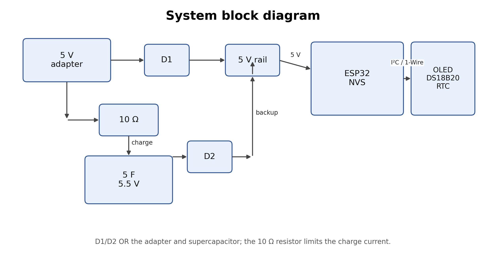

# Power-Fail-Safe Sensor Logger with Supercapacitor Hold-Up

**Project Proposal for Approval — Embedded Systems Mini-Project**

**Student:** Dandu Surath Preetham  
**Roll number:** BL.SC.U4CSE24212

---

## 1. Problem Statement

Embedded data loggers are often deployed where the power supply is unreliable. A sudden loss of the 5 V supply can interrupt a non-volatile memory write, corrupt the stored record, or leave the controller in an undefined state. A battery-backed UPS solves this problem but adds cost, charging circuitry, weight, and maintenance.

The project addresses the narrower and practically important case of a **short power interruption**:

> When the adapter is lost, the logger should have enough energy to finish the critical write, store a valid record, and recover that record on the next boot — without a battery.

Most low-cost student loggers assume that power stays on. This project treats power failure as a first-class design event.

---

## 2. Proposed Solution

A low-cost **power-fail-safe sensor logger** detects adapter loss, holds up the electronics with a **supercapacitor**, saves the last reading and timestamp to non-volatile memory with a CRC, and restores the record on the next boot.

*Figure 1: System block diagram. D1/D2 provide adapter OR-ing; the 10 Ω resistor limits the supercapacitor charge current; the adapter-sense divider is before D1.*

**Module connections:**

| ESP32 pin | Connects to | Notes |
|---|---|---|
| 3V3 | OLED VCC, DS3231 VCC, DS18B20 VDD, 4.7 kΩ pull-up | 3.3 V rail |
| GND | OLED GND, DS3231 GND, DS18B20 GND, LED cathode, buzzer, button, dividers, SC− | Common ground |
| GPIO21 | OLED SDA, DS3231 SDA | I²C data |
| GPIO22 | OLED SCL, DS3231 SCL | I²C clock |
| GPIO4 | DS18B20 DQ | 4.7 kΩ pull-up to 3.3 V |
| GPIO34 | Adapter-sense divider midpoint | ADC; divider before D1 |
| GPIO35 | Supercapacitor-sense divider midpoint | ADC |
| GPIO26 | 220 Ω → LED → GND | Status LED |
| GPIO25 | Buzzer → GND | Optional |
| GPIO16 | Button → GND | Optional |

- With the adapter present, D1 supplies the board and the supercapacitor charges through the 10 Ω resistor.
- When the adapter is removed, D1 blocks backfeed and D2 lets the supercapacitor supply the board.
- The adapter-sense divider is **before D1**, so it collapses to 0 V immediately when the adapter is unplugged.
- The ESP32 saves a CRC-protected NVS record and displays the status on an OLED.

Firmware sequence: `RUN → POWER_FAIL → SAVE → DISPLAY → WAIT → RECOVER → RUN`.

The record contains a magic number, sequence number, temperature, timestamp, power-fail flag, and CRC16. On boot, the firmware validates the record; a valid record with the power-fail flag set is displayed as `RECOVERED`.

---

## 3. Objectives

1. Detect the loss of the 5 V adapter within tens of milliseconds.
2. Hold up the ESP32 long enough to complete a non-volatile write.
3. Save the last temperature, timestamp, sequence number, power-fail flag, and CRC.
4. Validate the record on boot and display it as `RECOVERED`.
5. Measure the hold-up time, charge time, and recovery success rate over 20 cycles.

---

## 4. Hardware and Software

| Component (qty) | Purpose |
|---|---|
| ESP32 DevKit V1 ×1 | Controller; built-in NVS; USB programming |
| Supercapacitor, 5.5 V, 5 F ×1 | Hold-up; 4×1.5 F parallel is an alternative |
| 1N5819 Schottky diode ×2 | Power OR-ing (D1, D2) |
| 10 Ω, 5 W resistor ×1 | Charge-current limit |
| Resistor kit: 10 kΩ ×4, 4.7 kΩ ×1, 220 Ω ×2 | Dividers, DS18B20 pull-up, LED |
| 0.96" SSD1306 OLED, I²C ×1 | Status/recovery display |
| DS18B20 temperature sensor ×1 | Logged quantity |
| DS3231 RTC module + coin cell ×1 | Timestamp; coin-cell backup |
| Breadboard, terminal block, jumpers, 5 V adapter, USB cable, multimeter ×1 set | Prototyping, power, measurement |

**Software:** Arduino IDE with the ESP32 core; Adafruit GFX, Adafruit SSD1306, OneWire, DallasTemperature, RTClib, and the ESP32 `Preferences` library.

---

## 5. Demonstration and Expected Outcomes

1. Power the board from the 5 V adapter. The OLED shows live temperature, time, supercapacitor voltage, and power-fail count.
2. Unplug the adapter for about 2 seconds.
3. The OLED shows `POWER LOST` → `SAVING...` → `SAVED`.
4. Plug the adapter back in. The ESP32 restarts and shows `RECOVERED` with the last temperature and timestamp.
5. Repeat the unplug/replug cycle 20 times and measure the hold-up time.

**Deliverables:** a working prototype, a measured hold-up time, a 20-cycle recovery count, a CRC record-integrity check, a complete report, and a viva-ready explanation. No result is claimed before the prototype is tested.

---

## 6. Novelty and Limitations

Supercapacitor backup, brownout detection, NVS/EEPROM, and CRC-protected records are established techniques. This project **does not claim a new concept**. The contribution is a **low-cost, explainable power-fail architecture** with a discrete diode-OR path, a deterministic save/recover state machine, a CRC-protected NVS record, and a measured hold-up/recovery evaluation.

The simple diode-OR path does not fully isolate the supercapacitor when the adapter is present; this is documented as a prototype limitation. A power-path switch is future work.

---

## 7. References

1. Espressif Systems, *ESP32 Series Datasheet*.
2. Espressif Systems, *Non-Volatile Storage (NVS) Library* documentation.
3. Analog Devices/Maxim, *DS3231 RTC* datasheet.
4. Analog Devices/Maxim, *DS18B20 1-Wire Digital Thermometer* datasheet.
5. Texas Instruments, *AMS1117 1-A Low-Dropout Voltage Regulator* datasheet.
6. Vishay, *1N5819 Schottky Barrier Rectifier* datasheet.
